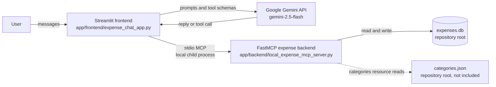

# MCP Expense Chatbot

## Which project is the latest?

**The current project is the MCP expense chatbot under `app/`.** Start it with:

```sh
uv run streamlit run app/frontend/expense_chat_app.py
```

The frontend is connected to this repository's local expense MCP backend:

```text
app/frontend/expense_chat_app.py
        │
        │ MCP over stdio (starts the backend as a child process)
        ▼
app/backend/local_expense_mcp_server.py
        │
        │ SQLite
        ▼
expenses.db (created in the repository root)
```

The scripts in `app/examples/` are older, separate experiments. They are **not** the current app and are not started by the current frontend.

## Project structure

```text
.
├── app/
│   ├── frontend/
│   │   └── expense_chat_app.py          # Current Streamlit frontend
│   ├── backend/
│   │   └── local_expense_mcp_server.py  # Current local expense MCP backend
│   └── examples/                        # Older standalone experiments
├── .env.example                         # Environment-variable template
├── .python-version                      # Python version used by uv
├── pyproject.toml                       # Project dependencies
├── requirements.txt                     # Exported compatibility dependency list
├── uv.lock                              # Locked dependencies
└── README.md
```

The important frontend/backend pairing is explicit in both the folder names and the MCP configuration inside [`app/frontend/expense_chat_app.py`](app/frontend/expense_chat_app.py). The frontend launches [`app/backend/local_expense_mcp_server.py`](app/backend/local_expense_mcp_server.py) using the same Python interpreter that is running Streamlit, so the local MCP connection does not depend on a machine-specific Python path.

## Which file is the backend?

The backend for the current chatbot is **[`app/backend/local_expense_mcp_server.py`](app/backend/local_expense_mcp_server.py)**. It is a FastMCP server named `ExpenseTracker`. It owns the expense tools and database access:

| Backend tool/resource | What it does |
| --- | --- |
| `add_expense` | Stores an expense in the root-level `expenses.db` SQLite database. |
| `list_expenses` | Reads expenses between inclusive start and end dates. |
| `summarize` | Totals expenses by category within the requested dates. |
| `expense://categories` | Reads `categories.json` from the repository root; that optional file is not currently included. |

The **frontend** is [`app/frontend/expense_chat_app.py`](app/frontend/expense_chat_app.py). It displays the Streamlit chat, calls Google Gemini, and connects to the backend over MCP stdio. The backend does not call Gemini or need a Gemini API key; the frontend uses `GOOGLE_API_KEY`.

### How the current frontend connects

No separate MCP configuration is needed to run this project’s frontend. Its `SERVERS` setting points at the backend script, and this command starts Streamlit:

```sh
uv run streamlit run app/frontend/expense_chat_app.py
```

When the frontend starts, the MCP adapter launches the backend as a child process using the current Python interpreter, discovers its tools, and makes them available to Gemini. Do not launch a second copy of the backend for this frontend.

### Connect the backend from another MCP host

An MCP-compatible desktop client can also launch the backend directly. For example, a client that supports the standard `mcpServers` JSON configuration can use this Windows configuration:

```json
{
  "mcpServers": {
    "local-expense": {
      "command": "uv",
      "args": [
        "run",
        "--directory",
        "C:\\Users\\YOUR_WINDOWS_USER\\path\\to\\Mcp ChatBot",
        "python",
        "app\\backend\\local_expense_mcp_server.py"
      ]
    }
  }
}
```

Replace `C:\\Users\\YOUR_WINDOWS_USER\\path\\to\\Mcp ChatBot` with the **absolute path to this repository on your computer**, save the JSON in the MCP host’s configuration file, and restart that host. Make sure `uv` is available on the host’s `PATH`. For macOS or Ubuntu, use the same JSON structure but replace the directory with the repository’s absolute POSIX path (for example, `/home/YOUR_USER/Mcp ChatBot`) and the script argument with `app/backend/local_expense_mcp_server.py`.

The equivalent terminal command from the repository root is:

```sh
uv run python app/backend/local_expense_mcp_server.py
```

This command runs an MCP stdio server for a host to launch; it is not an HTTP URL to enter into a remote-server field. An MCP host will show the tools as `add_expense`, `list_expenses`, and `summarize`. Connecting through an MCP host does not give that host a Gemini model automatically: the Streamlit frontend is the project component that combines Gemini with the backend tools.

## What the current app can do

The local MCP server exposes these expense tools:

- `add_expense(date, amount, category, subcategory="", note="")` — add an expense.
- `list_expenses(start_date, end_date)` — list expenses in an inclusive date range.
- `summarize(start_date, end_date, category=None)` — total expenses by category.
- `expense://categories` — read category data from `categories.json`.

Use ISO-formatted dates (`YYYY-MM-DD`) for reliable date-range filtering. The database is created automatically when the MCP backend starts.

**Income or “add money” tracking is not implemented yet.** The database contains expenses only; it does not currently track income, account balances, budgets, edits, or deletions. Also, `categories.json` is not included, so the categories resource will fail until that file is supplied; the expense tools themselves do not require it.

## Architecture



1. Streamlit loads the configured local MCP backend and discovers its tools.
2. The frontend binds the discovered tools to Google Gemini (`gemini-2.5-flash`).
3. A user message goes to the model. If the model requests an expense operation, the frontend invokes the corresponding local MCP tool.
4. The backend reads or writes the root-level SQLite database and returns the tool result.
5. The model uses that result to produce the response shown in the chat.

The current frontend uses the **local** expense backend. It does not connect to the remote expense URL, math server, or Manim server present in the older examples.

## Requirements

- Python 3.11 or newer
- [`uv`](https://docs.astral.sh/uv/)
- A Google Gemini API key for the current frontend
- Network access to the Google Gemini API

## Install `uv`

### macOS

```sh
curl -LsSf https://astral.sh/uv/install.sh | sh
```

Open a new terminal if `uv` is not found on `PATH`.

### Windows PowerShell

```powershell
powershell -ExecutionPolicy ByPass -c "irm https://astral.sh/uv/install.ps1 | iex"
```

Open a new PowerShell window if `uv` is not found on `PATH`.

### Ubuntu

```sh
curl -LsSf https://astral.sh/uv/install.sh | sh
```

If needed, install `curl` with `sudo apt update && sudo apt install curl`.

## Set up (macOS, Windows, and Ubuntu)

Run these commands from the repository root:

```sh
uv python install 3.11
uv sync
```

Create your local environment file:

**macOS / Ubuntu**

```sh
cp .env.example .env
```

**Windows PowerShell**

```powershell
Copy-Item .env.example .env
```

Edit `.env` and set your Google Gemini API key:

```dotenv
GOOGLE_API_KEY=your_google_gemini_api_key
```

Keep the real key in `.env`; that file is ignored by Git. Do not commit API keys.

## Run the current chatbot

From the repository root, on macOS, Windows, or Ubuntu:

```sh
uv run streamlit run app/frontend/expense_chat_app.py
```

Open the local URL Streamlit prints, usually `http://localhost:8501`. The frontend starts the local expense MCP backend automatically when it discovers tools. You do **not** need to start the backend in another terminal.

## Run the backend by itself

To run the MCP server from a separate MCP host/client, use:

```sh
uv run python app/backend/local_expense_mcp_server.py
```

This is an MCP stdio server, not a browser-accessible HTTP service. It normally waits for an MCP client to communicate over stdin/stdout. Stop it with `Ctrl+C`.

## Older experiments

`app/examples/` contains independent prototypes retained for reference:

- `calculator_langgraph_sync.py` and `calculator_langgraph_async.py` — calculator tools using LangGraph.
- `mcp_langgraph_remote_servers.py` — earlier LangGraph client with hard-coded external server configuration.
- `gemini_mcp_client.py` — Gemini client example with a machine-specific external server path.
- `package_scaffold.py` — generated package starter stub.

These examples are not part of the current Streamlit app. Some reference external servers or fixed prompts and need their own configuration and API keys.

## Data and safety notes

- The local expense database is `expenses.db` in the repository root. It is not encrypted by this application and is ignored by Git.
- The MCP server has no authentication or user isolation. Do not expose it to an untrusted network as-is.
- Chat prompts are sent to Google Gemini, and local expense-tool calls are handled by the configured MCP server. Avoid entering sensitive financial information unless those data flows are acceptable to you.
- Back up `expenses.db` if you need to keep its data.

## Troubleshooting

- **Gemini authentication error:** check that `.env` exists in the repository root and contains a valid `GOOGLE_API_KEY`.
- **MCP backend does not start:** run `uv sync` from the repository root and verify that `app/backend/local_expense_mcp_server.py` exists.
- **Category resource error:** create `categories.json` in the repository root; the local server currently expects it for `expense://categories`.
- **No income/balance tools appear:** those features are not implemented in the current backend yet.

## Push this project to GitHub

The local Git repository currently has no remote configured. First create a new, empty repository on GitHub (do not initialize it with a README, license, or `.gitignore`), then from this project folder run:

```sh
git add .
git commit -m "Organize Gemini MCP expense chatbot"
git remote add origin https://github.com/YOUR_USERNAME/YOUR_REPOSITORY.git
git push -u origin master
```

Replace the URL with the HTTPS URL shown by GitHub. If your branch is named `main` instead of `master`, use `git push -u origin main`. GitHub may open a browser to authenticate you. The `.env` file and local `expenses.db` are ignored by Git; verify that no secrets are staged before committing with `git status`.
